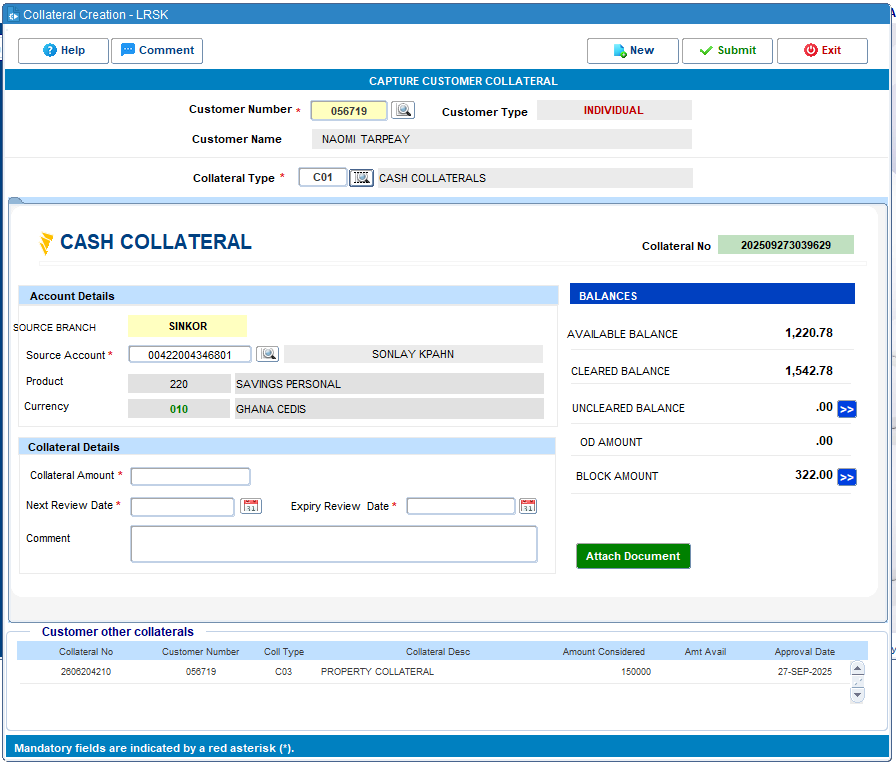
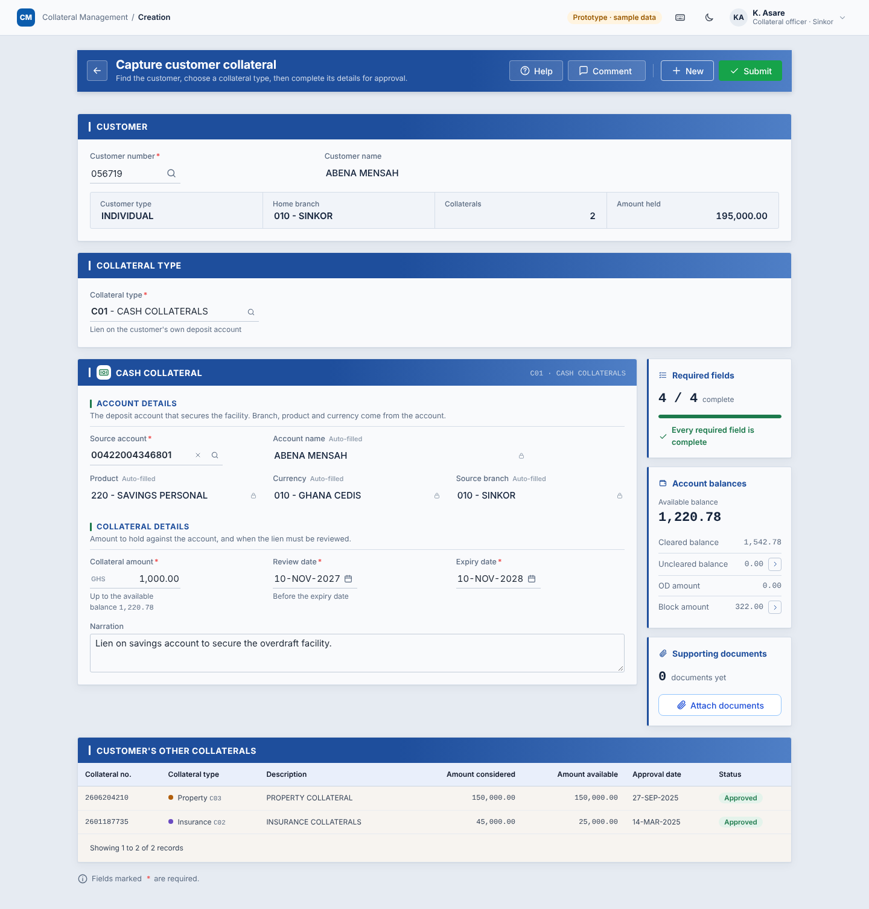
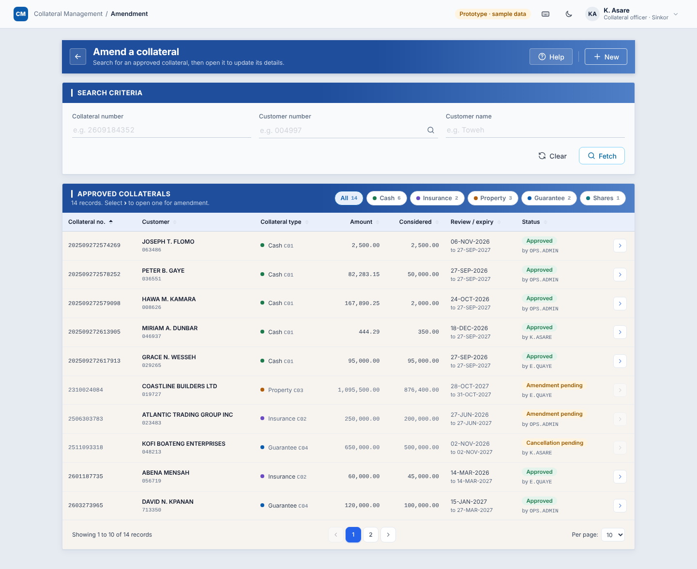
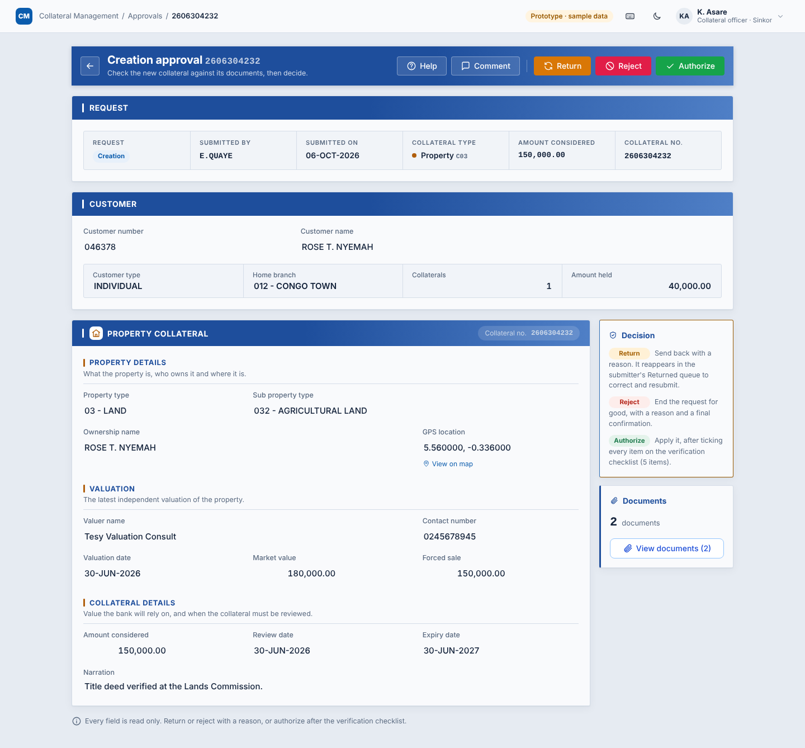
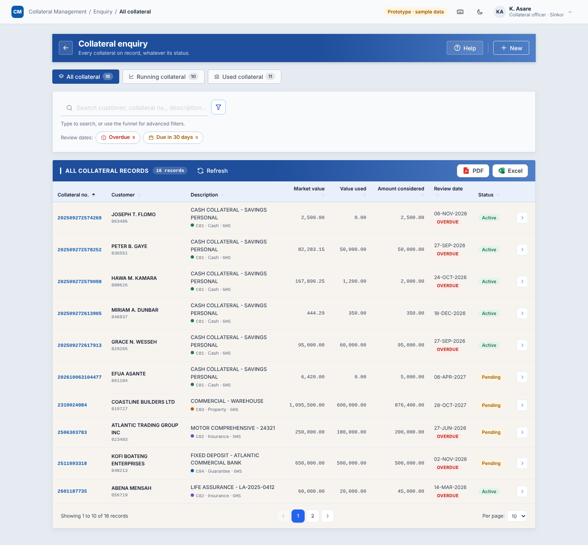

# Collateral Management: Oracle Forms → Angular

UI design, prototype and documentation for moving the Collateral Management (LRSK) screens from Oracle Forms to Angular. The mock-up was presented and approved; the Angular build is **on hold until the green light** ([next phase](docs/angular-next-phase.md)).

## Start here

| | |
|---|---|
| **Prototype** | Open [`design/prototype/index.html`](design/prototype/index.html) in a browser. All names, accounts and amounts are sample data |
| **Design rules** | [`docs/design-system.md`](docs/design-system.md): visual style, field widths, components, shortcuts, duplicate check, history |
| **Screenshots** | [`design/screens/`](design/screens/) |
| **Next phase** | [`docs/angular-next-phase.md`](docs/angular-next-phase.md): what the Angular build works from and what is still needed |
| **Training notes** | [`docs/training-notes.md`](docs/training-notes.md): each note from the training session and where it is handled |

## Modules

| Module | Spec | Flow from the PL/SQL |
|---|---|---|
| Creation | [spec](docs/creation/collateral-creation.md) | [creation and approval, payload](docs/creation/creation-approval-flow.html) |
| Amendment | [spec](docs/amendment/collateral-amendment.md) | [amendment and approval, payload](docs/amendment/amendment-approval-flow.html) |
| Cancellation | [spec](docs/cancellation/collateral-cancellation.md) | [cancellation and approval](docs/cancellation/cancellation-approval-flow.html) |
| Approvals | [spec](docs/approval/collateral-approval.md) | one queue for creation, amendment and cancellation |
| Returned (new) | in the [Approvals spec](docs/approval/collateral-approval.md) | [return and resubmit](docs/returned/return-flow.html) |
| Enquiry | [spec](docs/enquiry/collateral-enquiry.md) | draft |
| Reporting | [Review due / overdue](docs/reporting/review-due-overdue.md) | — |

## Contents

```
design/prototype/index.html   Interactive prototype for every module
design/prototype/maps/        Saved Monrovia street map for the GPS picker
design/screens/               Current screenshots (01 home … 22 mobile)
docs/                         Design system, next phase, training notes, a spec and flow per module
screenshots/                  The current Oracle Forms screens, for reference
```

## Before and after

| Oracle Forms | New design |
|---|---|
|  |  |
|  |  |
|  |  |
|  |  |

## Trying the prototype

It opens on the module **home**; each card opens a screen, and the back arrow on each screen leads back. A hash opens a screen directly: `#creation`, `#amendment`, `#cancellation`, `#approvals`, `#returned`, `#enquiry-all`, `#enquiry-running`, `#enquiry-used`, `#report-review`. **Ctrl+K** lists the keyboard shortcuts.

- **Creation:** starts with customer `056719` and a cash collateral. Pick another collateral type from the lookup, submit with empty fields to see the checks, then a complete submit. For the duplicate warning, create an Insurance collateral with insurer `002` and policy `LA-2025-0412`.
- **Amendment / Cancellation:** search (e.g. customer `004997`), open a record with **›**, change fields or give a closure reason, then **Submit**.
- **Approvals:** you can't decide on your own request (maker-checker). Switch user from the name at the top right (K. Asare, A. Mensah), open a request, then **Authorize**, **Return** or **Reject**. Returned requests appear under **Returned**, reopen on their entry screen and are resubmitted.
- **Enquiry:** search, open the funnel for advanced filters, export to PDF or Excel, and open **›** for details, usage and history.
- **Reports:** Review due / overdue, with parameters and exports.
